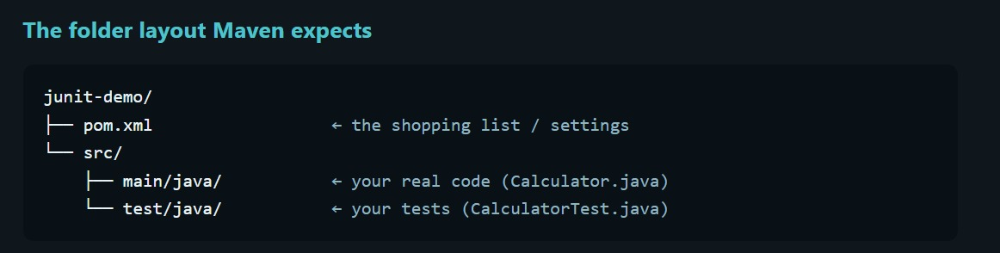
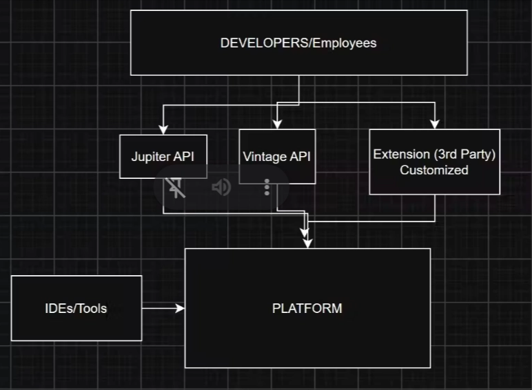

# Maven

## **What is a test?**

A unit test is a small piece of code that calls your code and checks whether the result is what you accepted.

**Analogy:** Before selling a cake, you might taste a slice to check whether it’s sweet enough and baked enough. A unit test is like a taste check that takes milliseconds and runs every time you change the recipe.

With tests, you can check whether everything still works with the press of a button.

JUnit is a library that lets you run tests.

Every test follows three main steps:

1. Arrange
2. Act
3. Assert
- **Arrange:** Set things up.
- **Act:** Do the thing.
- **Assert:** Check the answer.

```java
// Arrange: set things up
Calculator calc = new Calculator();

// Act: do the thing
int result = calc.add(2, 3);

// Assert: check the answer
assertEquals(5, result);
```

## What is Maven?

Maven is a project management and build tool. It downloads libraries and compiles your code.

Analogy:

Imagine you’re a chef: you write the recipe (Java code), and Maven is your kitchen manager. You hand over a shopping list (`pom.xml`), and the manager buys the ingredients, sets up the kitchen, and checks the outcome.



## Steps for JUnit Testing

1. Design: Understand the problem statement and explain the pseudocode.
2. Write the code.
3. Write tests.
4. Run the tests.

## Architecture of JUnit

JUnit Platform - The Engine room starts tests, talks with IDEs and  Maven defines how test engines plug in. It is used by VS Code, IntelliJ, and Maven Surefire.

Developers use it to run tests while writing them.



**JUnit Jupiter** **API-** It is  the new programming model- @Test and @BeforeEach, assertions, and the engine that runs Jupiter tests.
**JUnit Vintage API-** It is a compatibility engine that runs old JUnit 3 and JUnit 4 tests to run on the new JUnit Platform. It is useful by old projects that have not yet migrated.

**Analogy: A cinema hall**

The JUnit Platform is like the building, projection system, and ticket counter—it can support different movies. Jupiter is like a modern movie made for the platform.

Vintage is like an older movie that can runs on the same projector. The building does not care which movie is playing, as long as a Magic engine(player).


## Types of Testing

1. Unit Testing -Testing of a individual unit or method
2. Integration Testing - Testing of multiple modules or components together, to test if system  behaves properly when wired together(the goal is not to test end to end user behavior but check if the components does the  intended behavior)

Use case 01
Service → Repository → Database

Wired multiple modules of one component

1. You invoke a method in a service layer. 
2. Verify that the dependency injection works correctly.
3. The flow should reach the database layer.
4. Your test can assert that data was persisted properly into the database .

Service A → publish to Kafka 

Validate that the message is successfully publish to Kafka topic.

1. Functional Testing- End to end testing of a feature of a business functionality , verifying it works as expected.